<h3>⚡ About Me</h3>

I'm <b>Sujoy Moulick</b>, a B.Tech CSE student and full-stack developer building modern digital products, 
AI-powered tools, browser extensions and open-source apps.

This profile is my <b>digital workspace and portfolio</b> — where I experiment, learn, and turn ideas into 
real-world products with modern tech, clean UI/UX and AI-powered workflows.

<h3>🚀 SaaS Projects</h3>

<table>
<tr>
<td align="center" width="33%"><a href="https://sujoymoulick.github.io/EchoToDo-documentation/"><b>EchoToDo</b></a> Voice-powered productivity &amp; todo extension</td>
<td align="center" width="33%"><a href="https://freepdfly.com"><b>FreePDFly</b></a> Live SaaS · browser-based PDF toolkit</td>
<td align="center" width="33%"><a href="https://sendvirtualgift.com"><b>SendVirtualGift</b></a> Live SaaS · send virtual gifts online</td>
</tr>
</table>

<h3>🔗 Connect With Me</h3>

<picture>
  <source media="(prefers-color-scheme: dark)" srcset="https://raw.githubusercontent.com/Sujoymoulick/Sujoymoulick/output/pacman-contribution-graph-dark.svg">
  
</picture>

