<div align="center">

<a href="https://sujoymoulick.github.io/Sujoymoulick/">
  
</a>

<a href="https://sujoymoulick.github.io/Sujoymoulick/"></a>


<table>
<tr>
<td width="380" valign="top">

<pre>
███████╗██╗   ██╗     ██╗ ██████╗ ██╗   ██╗
██╔════╝██║   ██║     ██║██╔═══██╗╚██╗ ██╔╝
███████╗██║   ██║     ██║██║   ██║ ╚████╔╝ 
╚════██║██║   ██║██   ██║██║   ██║  ╚██╔╝  
███████║╚██████╔╝╚█████╔╝╚██████╔╝   ██║   
╚══════╝ ╚═════╝  ╚════╝  ╚═════╝    ╚═╝   
</pre>


<br>
<br>
<p align="center">

</p>


</td>
<td width="420" valign="top">

```ini
sujoy@github
─────────────
OS ...............  MAC.OS
Host .............  github.com/Sujoymoulick
Kernel ...........  curiosity
Runtime ..........  Python / JavaScript / C++
IDE ..............  VS Code

CAPABILITIES
Languages ........  C / C++ / Java / Python / JavaScript
AI ...............  LangChain / AI Automation / LLM Tools
Backend ..........  Node.js / Express
Databases ........  MongoDB / MySQL / Supabase
Frontend .........  React / Next.js / Tailwind / Astro
Infrastructure ...  Docker / AWS / Vercel / Cloudflare
Tools ............  Git / GitHub / Postman / Linux

INTERESTS
> AI & Automation
> Open Source Development
> Browser Extensions & Dev Tools
> Full Stack Web Products
> Understanding how things work under the hood

STATUS: BUILDING
[███████████████████████░░░░░]  80%

LEARNING DAILY
[██░░░░░░░░░░░░░░░░░░░░░░░░░░░]  20%
```

**ABOUT ME**

Welcome to my GitHub profile!
I'm **Sujoy Moulick**, a B.Tech CSE student and full-stack developer focused on building modern digital products, AI-powered tools, browser extensions, and open-source applications.

This GitHub profile acts as my **digital workspace and portfolio**, where I continuously experiment, learn, and create practical software solutions — turning ideas into real-world products using modern technologies, clean UI/UX, and intelligent workflows powered by AI.

**SAAS PROJECTS**
- [ EchoToDo](https://sujoymoulick.github.io/EchoToDo-documentation/) — Voice-powered productivity & todo extension
- [ FreePDFly](https://freepdfly.com) — Live SaaS, browser-based PDF toolkit
- [ SendVirtualGift](https://sendvirtualgift.com) — Live SaaS, send virtual gifts online


**CONNECT WITH ME**

<p align="center">

<a href="https://www.linkedin.com/in/sujoymoulick/">
  
</a>
<a href="https://github.com/Sujoymoulick">
  
</a>
<a href="https://sujoymoulick.vercel.app/">
  
</a>

</p>


</td>
</tr>
</table>





<picture>
  <source media="(prefers-color-scheme: dark)" srcset="https://raw.githubusercontent.com/Sujoymoulick/Sujoymoulick/output/pacman-contribution-graph-dark.svg">
  
</picture>


</div>
