

<a href="https://ascelstack.com">
  
</a>




<a href="https://sujoymoulick.github.io/EchoToDo-documentation/"></a>
<a href="https://freepdfly.com"></a>


<picture>
  <source media="(prefers-color-scheme: light)" srcset="https://raw.githubusercontent.com/Sujoymoulick/Sujoymoulick/output/snake-light.svg">
  
</picture>


<a href="https://www.linkedin.com/in/sujoymoulick/"></a>
<a href="https://github.com/Sujoymoulick"></a>
<a href="https://sujoymoulick.online/"></a>


